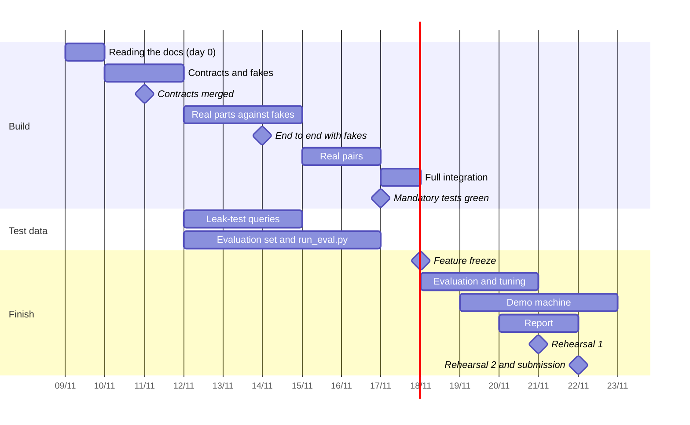

# Schedule

> Status: **v2**. Day 0 is Mon 2026-11-09: every group receives and reads the documents. Building starts on day 1, Tue 2026-11-10. Submission is on day 13, Sun 2026-11-22. Weekends are working days. Each part's own plan, day by day, is in its spec, §10.

---

## 1. Day by day

| Day | Date | Build | In parallel | Checkpoint |
|---|---|---|---|---|
| 0 | Mon 11-09 | Every group reads `architecture.md`, `00-shared.md` and its own spec, and raises its questions · repository, CI, CODEOWNERS and the shared contract code of 00-shared §3–§7 (`src/core/contracts/`) set up | | |
| 1 | Tue 11-10 | P5: app skeleton, `registry.py`, `config.py`, `logging.py`, user fixtures · every part starts its Protocol, fake and contract test | | |
| 2 | Wed 11-11 | Every part: Protocol + fake + contract test merged · P1: `sample_chunks.jsonl` · P3: `detect_language` · P5: `audited_stream` · P6: `ocr` service with a default engine (Tesseract `ara`) · P7: stack chosen, chat streaming the fake | | **Contracts and fakes merged** |
| 3 | Thu 11-12 | Real implementations, against fakes · P1: the 5–6 internal documents merged | Test questions: writers assigned, writing starts | |
| 4 | Fri 11-13 | Build | Test questions | |
| 5 | Sat 11-14 | Build | **Leak-test queries delivered** (`tests/sovereignty/leak_queries.jsonl`) · P1 chooses the OCR engine | **Each part works end to end with fakes** |
| 6 | Sun 11-15 | Real pairs: P1 + P2 (real ingestion into Qdrant) · P6 serves the real models | | |
| 7 | Mon 11-16 | Real pairs: P3 + P2 · P4 on the real LLM · P7 on the real API | **Evaluation set delivered** (`evaluation/dataset.jsonl`, 50+ questions) · `evaluation/run_eval.py` runs against the fakes | |
| 8 | Tue 11-17 | Full integration: every contract `real` · full corpus ingested | | **Mandatory tests (a) and (b) green; end-to-end test green** |
| 9 | Wed 11-18 | **Feature freeze** | First evaluation run; results shared with every group | |
| 10 | Thu 11-19 | Tuning and bug fixes · demo machine set up, offline test | | |
| 11 | Fri 11-20 | Tuning and bug fixes | Second evaluation run (evening) · report sections drafted · `docs/evaluation.md` | |
| 12 | Sat 11-21 | Fixes only | Report assembled · **demo rehearsal 1** | |
| 13 | Sun 11-22 | Fixes only (morning) | **Demo rehearsal 2** · **submission** | |

---

## 2. Rules

- **Day 0 is for reading.** Questions about a spec are raised on day 0 or day 1, so answers arrive before the contracts are merged on day 2.
- **Integration in pairs (days 6–7).** Parts that depend on each other switch to `real` together first, so day 8 only joins pairs that already work.
- **Day-2 items that depend on another day-2 item** (P3's `/ask` through `audited_stream`, P7's chat on `/ask` and login) may use a local stub on day 2 and switch to the real one on day 3.
- **Feature freeze (day 9).** From day 9, only tuning and bug fixes are merged. A new feature after that point is out of the submission.
- **Fixes only (days 12–13).** Each fix is tested on the demo machine before it is merged. Nothing is merged after rehearsal 2.
- **Rehearsals** are full practice runs of the final demo: on the demo machine, with the internet off, by the people who will present, following `docs/demo.md` (P7), timed. Rehearsal 1 finds the problems; rehearsal 2 confirms they are fixed.

---

## 3. Tuning (days 10–11)

Each group tunes its own starting values from the evaluation results, changing `config.yaml` only:

| Part | Values |
|---|---|
| P1 | `ingestion.max_chunk_chars`, `ingestion.overlap_chars`, `ingestion.strategy` |
| P2 | `retrieval.top_k_vector`, `retrieval.top_k_bm25`, `retrieval.rerank_top_n` |
| P3 | `agents.grade_top_n`, `agents.min_relevant`, `agents.max_iterations`, `agents.max_tokens_per_request` |
| P4 | `agents.confidence_unknown_below`, `answer.web_confidence_cap` |
| P6 | `leak.overlap_threshold`, `leak.min_hits` (on the leak-test queries), `llm.narration_model`, `llm.num_ctx` |

Every change is recorded with its before / after evaluation figures in `docs/evaluation.md`.

---

## 4. Report

- Written in French.
- Each group writes the section on its own part: what it does, the main choices, its tests and results (day 11).
- The sections are assembled into one report, with a common introduction, the architecture, the evaluation results and the conclusion (day 12).
